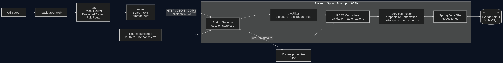
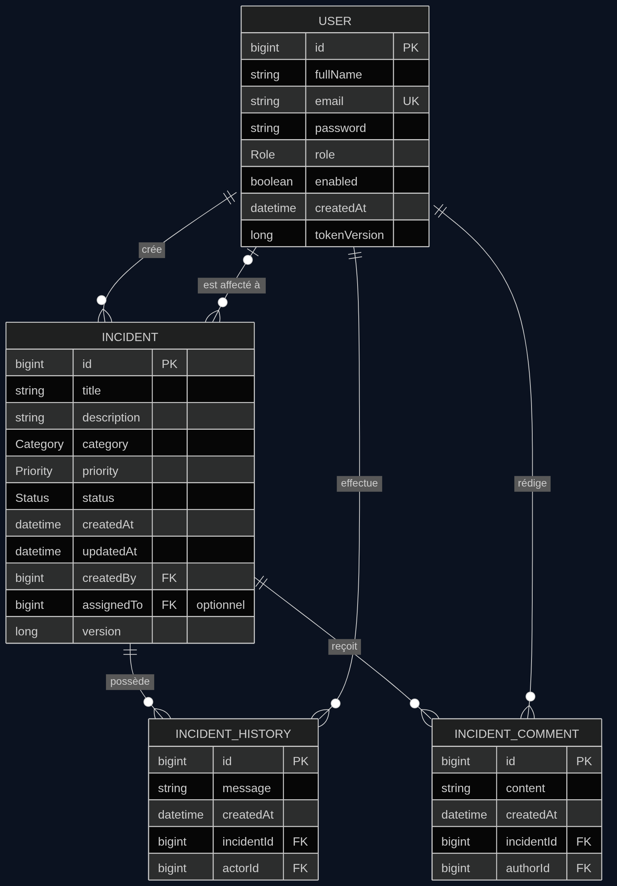

# SecWatch

## Contexte du TP

**Matière :** Sécurité des systèmes distribués  
**Devoir :** Authentification et autorisation avec Spring Security, JWT et React

SecWatch est une application web réalisée dans le cadre de ce TP. Elle permet de déclarer des incidents informatiques, de les affecter à des techniciens et de suivre leur traitement. Le projet met en pratique l'authentification par JWT et le contrôle d'accès par rôles entre une interface React et une API Spring Boot.

L'application distingue trois rôles : **EMPLOYEE**, **TECHNICIAN** et **ADMIN**. Les vérifications d'accès sont effectuées côté serveur : masquer une page ou un bouton dans l'interface ne remplace pas les contrôles de l'API.

## Architecture

Le frontend React communique avec une API REST Spring Boot. Spring Security valide le JWT avant l'accès aux routes protégées. Les services appliquent les règles métier, puis Spring Data JPA communique avec H2 ou MySQL.

## Modèle de données

Les entités principales sont <code>User</code>, <code>Incident</code>, <code>IncidentHistory</code> et <code>IncidentComment</code>. Un incident appartient à son créateur et peut être affecté à un technicien. Il peut aussi contenir plusieurs événements d'historique et commentaires.

## Stack technique

### Backend

- Java 21 et Spring Boot 3
- Spring Web et API REST
- Spring Security et authentification JWT (JJWT)
- Spring Data JPA et validation Jakarta
- H2 par défaut; pilote MySQL disponible

### Frontend

- React 18, Vite et React Router
- Axios pour les appels API et l'en-tête Bearer
- Tailwind CSS 4 et composants d'interface inspirés de shadcn/ui
- Lucide React pour les icônes
- Thème clair/sombre mémorisé dans le navigateur
- Palette zinc et teal

## Fonctionnalités

- Inscription publique et connexion; toute nouvelle inscription reçoit le rôle <code>EMPLOYEE</code>.
- JWT signé, stateless et expirant (300 secondes par défaut).
- Hachage des mots de passe avec BCrypt.
- Contrôle des routes selon le rôle, le propriétaire de l'incident et l'affectation au technicien.
- Création et suivi des incidents, affectation, changement de statut, commentaires et historique.
- Profil utilisateur et changement de mot de passe.
- Administration des utilisateurs et tableaux de bord adaptés à chaque rôle.
- Validation des données et réponses d'erreur HTTP structurées.
- Déconnexion côté frontend lorsque l'API répond <code>401</code> pour une session expirée.

Les statuts d'incident sont <code>OPEN</code>, <code>ASSIGNED</code>, <code>IN_PROGRESS</code>, <code>RESOLVED</code> et <code>CLOSED</code>. Un incident clôturé ne peut plus être modifié ni recevoir de commentaire.

## Prérequis

- Java 21
- Maven 3.9 ou supérieur
- Node.js et npm

## Démarrage en local

Depuis la racine du dépôt, démarre le backend dans un terminal :

~~~bash
cd backend
mvn spring-boot:run
~~~

L'API est disponible sur <http://localhost:8080>. La base H2 persistante est créée dans <code>backend/.data/secwatch</code>. La console H2 est accessible sur <http://localhost:8080/h2-console> avec les paramètres suivants :

| Paramètre | Valeur |
|---|---|
| JDBC URL | <code>jdbc:h2:file:./.data/secwatch</code> |
| Utilisateur | <code>sa</code> |
| Mot de passe | vide |

Dans un second terminal, démarre le frontend :

~~~bash
cd frontend
npm install
npm run dev
~~~

Ouvre l'adresse Vite affichée dans le terminal, généralement <http://localhost:5173>.

Par défaut, le frontend appelle <code>http://localhost:8080</code>. Pour utiliser une autre URL d'API, définis <code>VITE_API_URL</code> dans l'environnement du frontend.

## Configuration du backend

Les valeurs par défaut conviennent au développement local. Elles peuvent être remplacées par des variables d'environnement :

| Variable | Valeur par défaut | Rôle |
|---|---|---|
| <code>PORT</code> | <code>8080</code> | Port HTTP du backend |
| <code>DATABASE_URL</code> | <code>jdbc:h2:file:./.data/secwatch</code> | URL JDBC de la base |
| <code>DATABASE_USER</code> | <code>sa</code> | Utilisateur de la base |
| <code>DATABASE_PASSWORD</code> | vide | Mot de passe de la base |
| <code>JWT_SECRET</code> | Clé locale de démonstration | Secret de signature JWT; fournir une clé d'au moins 32 octets hors démonstration |
| <code>JWT_TTL_SECONDS</code> | <code>300</code> | Durée de validité du JWT en secondes |
| <code>CORS_ORIGIN</code> | <code>http://localhost:5173</code> | Origine autorisée pour le frontend |
| <code>SEED_DEMO</code> | <code>true</code> | Création des comptes de démonstration |

Pour MySQL, configure <code>DATABASE_URL</code>, <code>DATABASE_USER</code> et <code>DATABASE_PASSWORD</code>, par exemple avec une URL JDBC de la forme <code>jdbc:mysql://localhost:3306/secwatch</code>.

## Comptes de démonstration

Les comptes sont créés au démarrage lorsque <code>SEED_DEMO=true</code>. Le mot de passe commun est <code>Demo1234!</code>.

| Rôle | Adresse |
|---|---|
| ADMIN | <code>admin@secwatch.local</code> |
| TECHNICIAN | <code>tech@secwatch.local</code> |
| EMPLOYEE | <code>employee@secwatch.local</code> |
| EMPLOYEE | <code>employee2@secwatch.local</code> |

Ces identifiants sont réservés à l'environnement local du TP.

## Principales routes de l'API

| Méthode | Route | Accès |
|---|---|---|
| <code>POST</code> | <code>/auth/register</code>, <code>/auth/login</code> | Public |
| <code>GET</code>, <code>PUT</code> | <code>/api/profile</code> | Utilisateur authentifié |
| <code>PUT</code> | <code>/api/profile/password</code> | Utilisateur authentifié |
| <code>POST</code> | <code>/api/incidents</code> | <code>EMPLOYEE</code> |
| <code>GET</code> | <code>/api/incidents/my</code> | <code>EMPLOYEE</code> |
| <code>GET</code> | <code>/api/incidents/assigned</code> | <code>TECHNICIAN</code> |
| <code>GET</code> | <code>/api/incidents</code> | <code>ADMIN</code> |
| <code>GET</code> | <code>/api/incidents/{id}</code> | Propriétaire, technicien affecté ou <code>ADMIN</code> |
| <code>PUT</code> | <code>/api/incidents/{id}/status</code> | Technicien affecté ou <code>ADMIN</code> |
| <code>PUT</code> | <code>/api/incidents/{id}/assign/{technicianId}</code> | <code>ADMIN</code> |
| <code>POST</code> | <code>/api/incidents/{id}/comments</code> | Technicien affecté ou <code>ADMIN</code> |
| <code>GET</code> | <code>/api/admin/users</code> | <code>ADMIN</code> |
| <code>PUT</code> | <code>/api/admin/users/{id}/enable</code> ou <code>/disable</code> | <code>ADMIN</code> |
| <code>GET</code> | <code>/api/admin/statistics</code>, <code>/api/admin/dashboard</code> | <code>ADMIN</code> |

Les erreurs API incluent un code <code>status</code> et un message. Les principaux codes traités sont <code>400</code> (validation), <code>401</code> (authentification ou JWT), <code>403</code> (accès interdit), <code>404</code> (ressource absente) et <code>409</code> (conflit).

## Scénario de démonstration

1. Connecte-toi comme <code>employee@secwatch.local</code> et crée un incident.
2. Connecte-toi comme <code>employee2@secwatch.local</code> et essaie de consulter l'incident du premier compte : l'accès doit être refusé.
3. Connecte-toi comme administrateur, consulte les incidents et affecte-en un au technicien.
4. Connecte-toi comme technicien, ouvre l'incident affecté, change son statut et ajoute une note.
5. Reviens sur le compte employé et vérifie le statut et l'historique de l'incident.

La collection Postman est disponible dans <code>postman/SecWatch.postman_collection.json</code>.

## Formatage du frontend

Pour reformater les fichiers frontend avec Prettier :

~~~bash
cd frontend
npm run format
~~~
